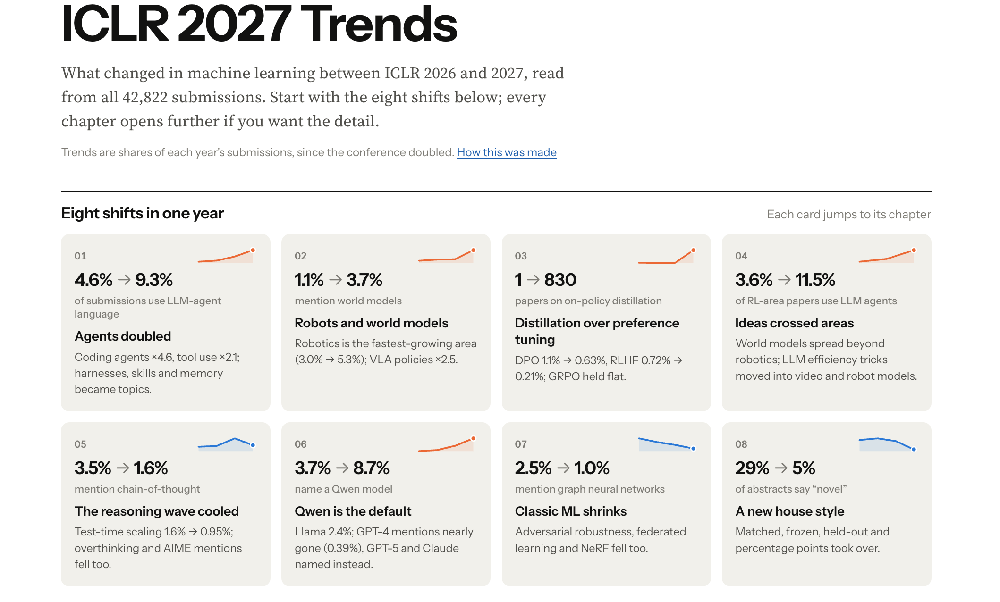

# ICLR 2027 Trends

What changed in machine learning between ICLR 2026 and 2027, read from all 42,822 submissions.

## Structure

| Section | What it covers |
|---|---|
| [Overview](https://txie1.github.io/iclr2027-trends/#top) | **8 headline shifts**, each linking to its chapter, and how much the conference grew |
| [1.&nbsp;Movers](https://txie1.github.io/iclr2027-trends/#movers) | Which topics **rose and fell**, and how big each one is |
| [2.&nbsp;Areas](https://txie1.github.io/iclr2027-trends/#areas) | For each of **12 research areas**: what's rising, cooling and new, with papers to read |
| [3.&nbsp;New&nbsp;ideas](https://txie1.github.io/iclr2027-trends/#new) | **16 new ideas** that barely existed in 2026: what each one is, why it appeared now, where to start reading |
| [4.&nbsp;Crossovers](https://txie1.github.io/iclr2027-trends/#cross) | Which ideas **moved into other areas**, what each area borrows, and which ideas now appear together |
| [5.&nbsp;Models](https://txie1.github.io/iclr2027-trends/#models) | Which **model families** papers build on, and how **benchmarks** moved |
| [6.&nbsp;Style](https://txie1.github.io/iclr2027-trends/#style) | How the **language** of abstracts changed in one year |
| [7.&nbsp;Explore](https://txie1.github.io/iclr2027-trends/#explore) | Chart any term from 2024 to 2027, or browse all 112 tracked terms |
| [Method](https://txie1.github.io/iclr2027-trends/#method) | How the report was made and what to distrust |

Each chapter leads with one message and one chart. Click to open the detail, and hover or tap a chart for exact numbers.

## About the data

- Built from OpenReview metadata (titles, abstracts, keywords and primary areas, no PDFs).
- Most trends are shares of each year's submissions, because the conference more than doubled. ×2 means a topic's share doubled.
- Topics are matched with text patterns, so a mention isn't the same as use. Written summaries came from model readers working from samples of abstracts.
- ICLR reviews are double-blind, so the report names no authors. Desk-rejected and withdrawn papers are counted but not listed.
- Paper titles and abstracts belong to their authors. This repository holds only the report, not the underlying data.
